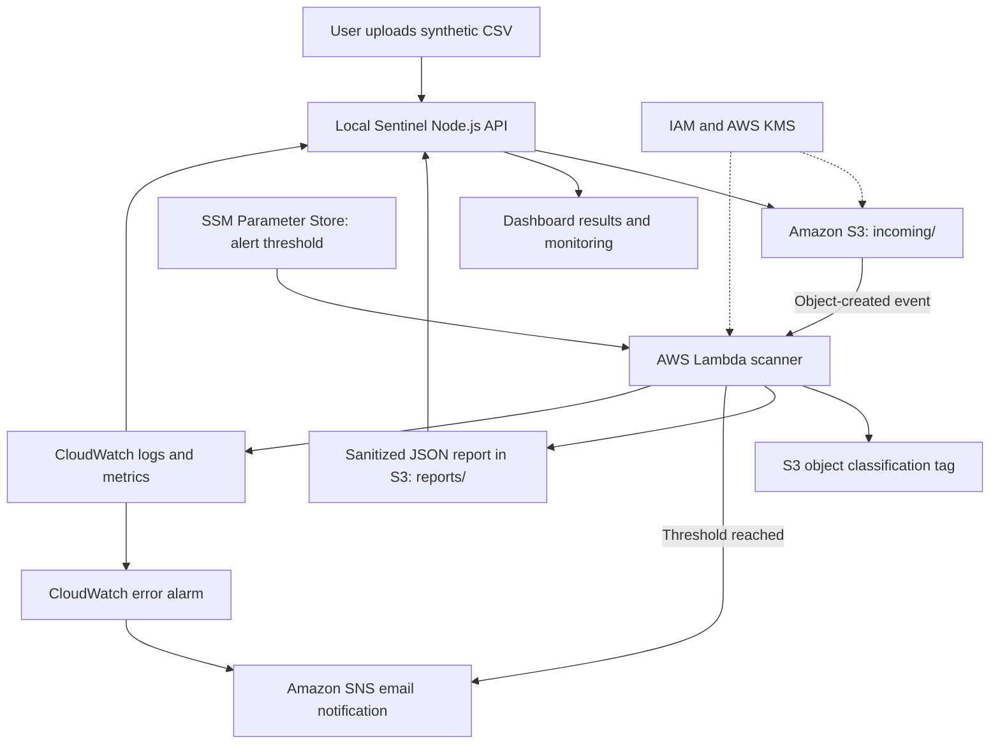

<div align="center">

# 🛡️ Sentinel
### AWS Data Protection, Encryption & Security Monitoring

**An automated, serverless data-protection prototype built for the DEPI Industry Project (2026).**


**Secure uploads · Automated classification · Encrypted storage · Security alerts · Audit visibility**

[Project Overview](#-overview) · [Dashboard](#-sentinel-dashboard) · [Results](#-verified-results) · [Run Locally](#-getting-started) · [Documentation](#-documentation)

</div>

> **Deployment status:** The AWS environment was deployed and tested in October 2026, then **intentionally deleted** to avoid continued AWS credit usage. This repository preserves the implementation, sanitized sample data, historical screenshots, test evidence, and documentation. **It does not contain a currently running AWS deployment.**

## 📌 Overview

Organizations storing customer records in the cloud need more than a storage bucket: they need encryption, controlled access, visibility into sensitive data, and a way to detect failures.

**Sentinel** demonstrates a practical AWS workflow in which a CSV file uploaded to Amazon S3 is processed automatically by AWS Lambda. The function checks for predefined sensitive-data patterns, applies a classification tag, writes a sanitized JSON report, and sends an email alert when the configurable detection threshold is reached. A responsive web dashboard makes reports and operational health easy to inspect.

The prototype uses **synthetic data only** and is designed for learning, demonstration, and reproducible security testing—not production data processing or regulatory certification.

## 🖥️ Sentinel Dashboard

The user interface is built using **HTML, CSS, and vanilla JavaScript**, with a **local Node.js server** handling AWS SDK calls. AWS credentials remain on the server side, never in browser code.

The dashboard includes an overview with scan counts, a CSV upload page, searchable classification reports, read-only S3 security checks, and CloudWatch monitoring. The original system was connected to AWS during testing; the uploaded source also supports an offline **Demo Data** mode now that the cloud resources have been removed.

### Evidence from the deployment

**Automated report generation** — Reports were stored under the encrypted S3 `reports/` prefix.


**Successful Lambda execution** — An S3-triggered invocation processed a sample upload.


You can find additional historical AWS screenshots in [`evidence/`](evidence/).

### What the dashboard provides

| Page | Capability |
|---|---|
| **Overview** | Recent scan results and classification statistics |
| **Upload & Scan** | Submit a synthetic CSV to the protected `incoming/` S3 prefix in live mode |
| **Scan Reports** | Read JSON reports from S3, search and filter results, and download report files |
| **Security Controls** | Read-only checks for public-access block, versioning, HTTPS enforcement, and SSE-KMS |
| **Monitoring** | CloudWatch Lambda invocations, errors, and the error-alarm state |

## ⚙️ How It Works



**End-to-end processing:**

1. A user uploads a `.csv` file to `incoming/` using the dashboard (or S3 directly).
2. S3 triggers Lambda only for matching object-creation events.
3. Lambda reads the file and evaluates configured regular-expression patterns.
4. Lambda labels the object **Confidential** if matches are found, otherwise **Internal**.
5. Lambda writes a sanitized JSON report to `reports/`, without copying detected personal-information values into the report.
6. When the count reaches the Parameter Store threshold, Lambda publishes an SNS email alert.
7. CloudWatch records execution activity and can notify SNS when Lambda errors trigger the alarm.

### AWS services and their roles

| Service | Role |
|---|---|
| **Amazon S3** | Versioned, private file storage for uploads and scan reports |
| **AWS KMS** | Customer-managed key for S3 server-side encryption (SSE-KMS) |
| **AWS IAM** | Least-privilege access for users, Lambda, and the local dashboard |
| **AWS Lambda** | Event-driven scanning, classification, reporting, and notification |
| **SSM Parameter Store** | Configurable sensitive-pattern alert threshold |
| **AWS Secrets Manager** | Demonstration of protected credential storage; **not consumed by Lambda** |
| **Amazon SNS** | Sensitive-data notifications and CloudWatch alarm emails |
| **Amazon CloudWatch** | Lambda logs, metrics, and error alarms |
| **AWS CloudTrail** | Historical management-event visibility and offline event analysis |
| **IAM Access Analyzer** | External-access findings review |

Additional architecture and data-flow diagrams are available under [`diagrams/`](diagrams/).

## ✅ Verified Results

The following observations come from the project tests and captured evidence; they are **not benchmark claims**.

| Test / observation | Result |
|---|---|
| Synthetic customer CSV | **6 pattern matches:** 3 email addresses + 3 Egyptian mobile numbers |
| S3-to-Lambda workflow | Automatic classification tag and JSON report created |
| Sensitive-file notification | SNS email successfully received |
| CloudWatch failure alert | Error alarm entered `ALARM` and sent an email |
| CloudTrail offline analysis | **973 events** processed; **17** security-setting changes flagged for review; **0** high-risk rule matches |
| Anonymous object request | `AccessDenied` returned as expected |
| Restricted IAM + KMS test | No-decrypt access denied; scoped decrypt subsequently allowed while write/delete stayed denied |
| Dashboard security API | **5 of 5** selected security settings returned `true` |
| IAM Access Analyzer | No external-access findings reported during the check |

The recorded monitoring screenshot shows **31 Lambda invocations and 28 errors** over its displayed 24-hour window. Those errors occurred during the development and permissions-troubleshooting period; they should **not** be interpreted as production reliability statistics. Multiple dashboard scans of `customers_demo.csv` are repeat executions of the **same synthetic dataset**, not independent datasets.

**Not independently verified in the supplied final evidence:** the clean-file no-alert result and return of the CloudWatch alarm to `OK` after the induced error. Re-run these tests if you redeploy the system; see [`documentation/testing-matrix.csv`](documentation/testing-matrix.csv).

## 📂 Repository Structure

```text
Sentinel-AWS-Data-Protection/
├── frontend/
│   ├── public/
│   │   ├── index.html           # Dashboard layout
│   │   ├── styles.css           # Responsive styling
│   │   └── app.js               # Browser interactions
│   ├── server.mjs               # Local Node.js API / AWS SDK
│   ├── iam-dashboard-policy.json
│   ├── .env.example             # Configuration template; no secrets
│   ├── package.json
│   └── sample-data/
├── lambda/
│   └── lambda_function.py       # S3-triggered classification function
├── security-scripts/
│   ├── sensitive_data_scanner.py
│   └── cloudtrail_event_analyzer.py
├── sample-data/                 # Synthetic CSVs and example report
├── diagrams/                    # Architecture and data-flow graphics
├── evidence/                    # Historic AWS + dashboard screenshots
├── documentation/               # Reports, slide deck, tests, risks
├── SECURITY.md
└── README.md
```

## 🚀 Getting Started

### Option A — Explore locally (no AWS account required)

**Requirements:** Node.js 20+ and npm.

```bash
git clone https://github.com/YOUR-USERNAME/AWS-Data-Protection-System.git
cd AWS-Data-Protection-System/frontend
npm install
npm start
```

Visit **http://127.0.0.1:3000**.

The dashboard defaults to **Demo Data** mode. It uses local in-memory sample data, never invokes AWS, and resets on server restart. Try `frontend/sample-data/customers_demo.csv` or `frontend/sample-data/clean_test.csv`.

> Replace `YOUR-USERNAME` with the account that owns your GitHub repository. If you downloaded the project as a ZIP instead of cloning it, open its `frontend/` directory and run the last two commands there.

### Option B — Connect a new AWS deployment

**The original AWS resources have been deleted.** Live mode requires deploying new resources and setting up permissions first. There is no one-click infrastructure deployment in this repository.

1. Provision a private S3 bucket with versioning, HTTPS-only access, appropriate lifecycle rules, and SSE-KMS using a customer-managed key.
2. Set up an AWS Lambda Python function from [`lambda/lambda_function.py`](lambda/lambda_function.py) and a least-privilege execution role, including S3 read/tag/report, KMS, Parameter Store and SNS permissions.
3. Create the SSM Standard String parameter `/depi/scanner/alert-threshold` with a positive integer, such as `1`.
4. Create an **SNS Standard topic**, confirm an email subscription, and configure the Lambda environment variable `SNS_TOPIC_ARN`.
5. Add an S3 ObjectCreated trigger **restricted to prefix `incoming/` and suffix `.csv`**, so writing into `reports/` never retriggers the scanner.
6. Configure CloudWatch logging, an error alarm, and the desired audit settings.
7. Create a dedicated dashboard identity and adapt [`frontend/iam-dashboard-policy.json`](frontend/iam-dashboard-policy.json) to the **new S3 bucket and KMS key**; never grant administrator permissions to the dashboard.
8. Configure the AWS CLI profile using temporary authentication, then copy `frontend/.env.example` to `frontend/.env` and set:

   ```dotenv
   DEMO_MODE=false
   AWS_REGION=us-east-1
   AWS_BUCKET=YOUR-NEW-BUCKET-NAME
   AWS_LAMBDA_FUNCTION=depi-data-protection-scanner
   AWS_ERROR_ALARM=DEPI-Lambda-Error-Alarm
   AWS_PROFILE=depi-dashboard
   PORT=3000
   ```

9. From `frontend/`, run `npm install` and `npm start`, then check for **AWS Connected** in the top bar.

**Security reminder:** Never commit `.env`, credentials, access keys, secret values, customer data, or unredacted CloudTrail exports. The local Node.js server is intended for `127.0.0.1` only; **do not expose it publicly without authentication and additional hardening**. Review [`frontend/README.md`](frontend/README.md) for a more detailed local setup.

### Useful offline scripts

Run these locally with Python 3:

```bash
python security-scripts/sensitive_data_scanner.py sample-data/customers_demo.csv
python security-scripts/cloudtrail_event_analyzer.py YOUR-EXPORTED-EVENTS.csv
```

Keep any raw CloudTrail export private: it may contain account identifiers and security metadata.

## 📑 Documentation

| Document | File |
|---|---|
| **Technical report (revised, with frontend evidence)** | [PDF](documentation/DEPI_AWS_Data_Protection_Technical_Report.pdf) · [DOCX](documentation/DEPI_AWS_Data_Protection_Technical_Report.docx) |
| **Project presentation** | [PPTX](documentation/DEPI_AWS_Data_Protection_Presentation.pptx) · [PDF](documentation/DEPI_AWS_Data_Protection_Presentation.pdf) |
| **Test matrix** | [Testing results](documentation/testing-matrix.csv) |
| **Security controls** | [Compliance/control matrix](documentation/compliance-matrix.csv) |
| **Risk assessment** | [Risk register](documentation/risk-register.csv) |
| **Project planning** | [Planning and requirements](documentation/project-management.md) |
| **Evidence notes** | [Screenshot references](documentation/EVIDENCE_NOTES.md) |

## 🔒 Security & Scope

- **No real personal information:** all supplied examples use synthetic customer data.
- **Limited detection:** regular expressions can produce false positives and miss sensitive information. This is not a comprehensive discovery engine.
- **Classification ≠ quarantine:** the S3 `Classification` tag is metadata, not an automatic access-denial control.
- **Historical audit coverage:** the offline CloudTrail analysis checks only exported events and a small set of rules; zero high-risk flags does **not** mean the account had no threats.
- **Compliance:** security controls were demonstrated for a student prototype, not independently certified against a law or compliance standard.
- **Deployment:** the original cloud resources were removed after testing; rerunning live mode can consume AWS credits or incur applicable charges.
- **Code provenance:** the Lambda file was recovered from earlier working project files and may need comparison with the final deployed revision if it was changed afterward.

See [`SECURITY.md`](SECURITY.md) for repository safety guidance.

---

<div align="center">

**Sentinel — Protecting cloud data with automation, encryption, and visibility.**

*Developed as part of the DEPI Industry Project · 2026*

</div>
